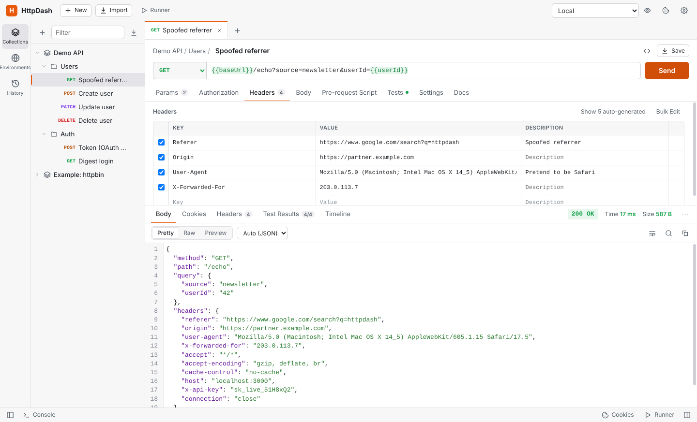
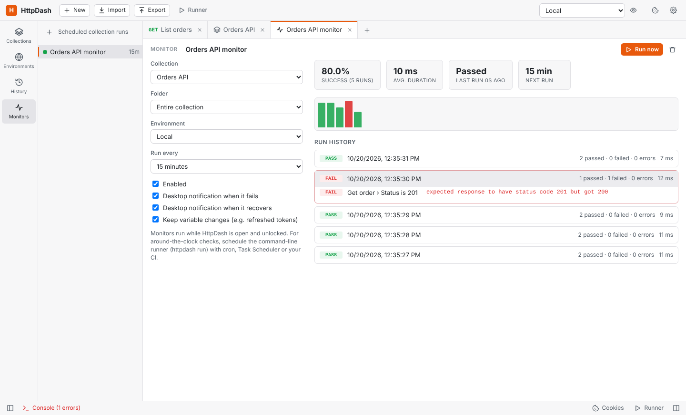
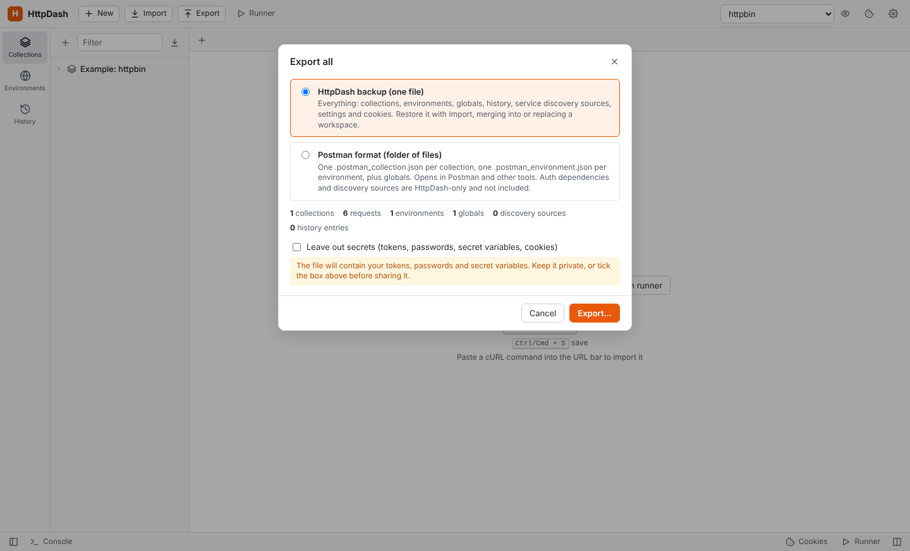
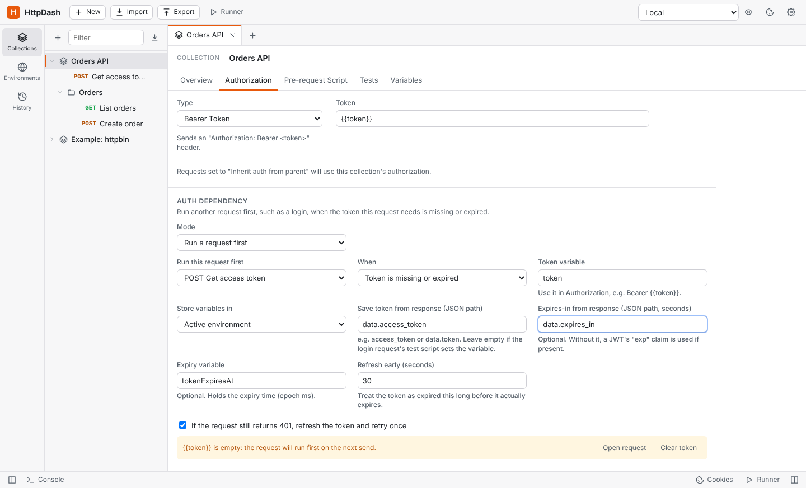
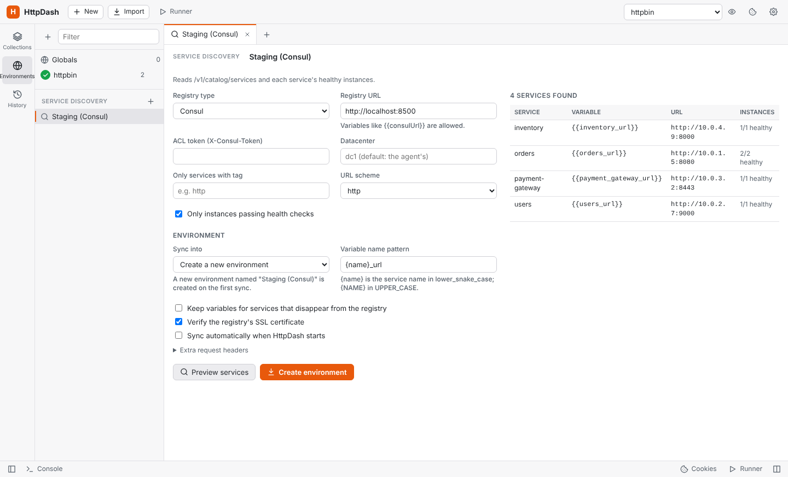
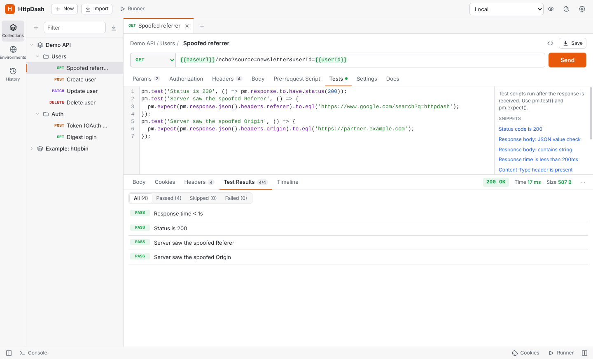
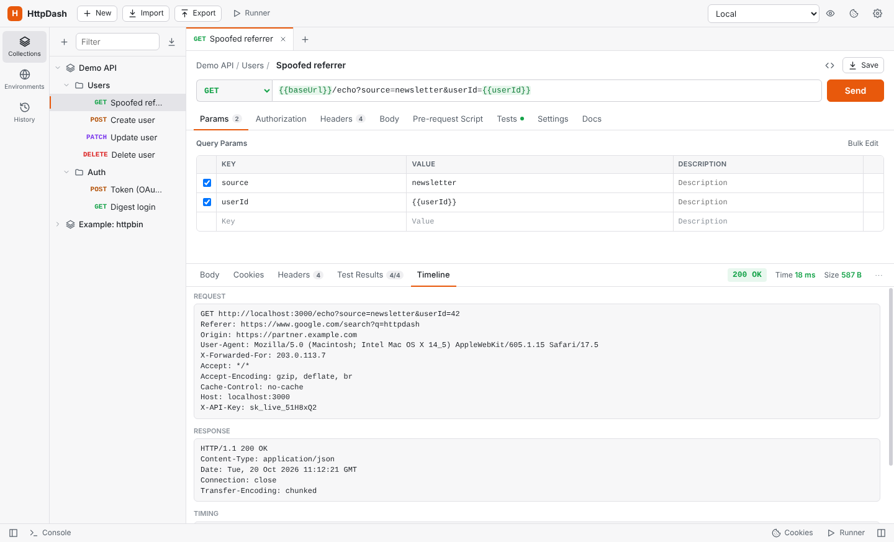
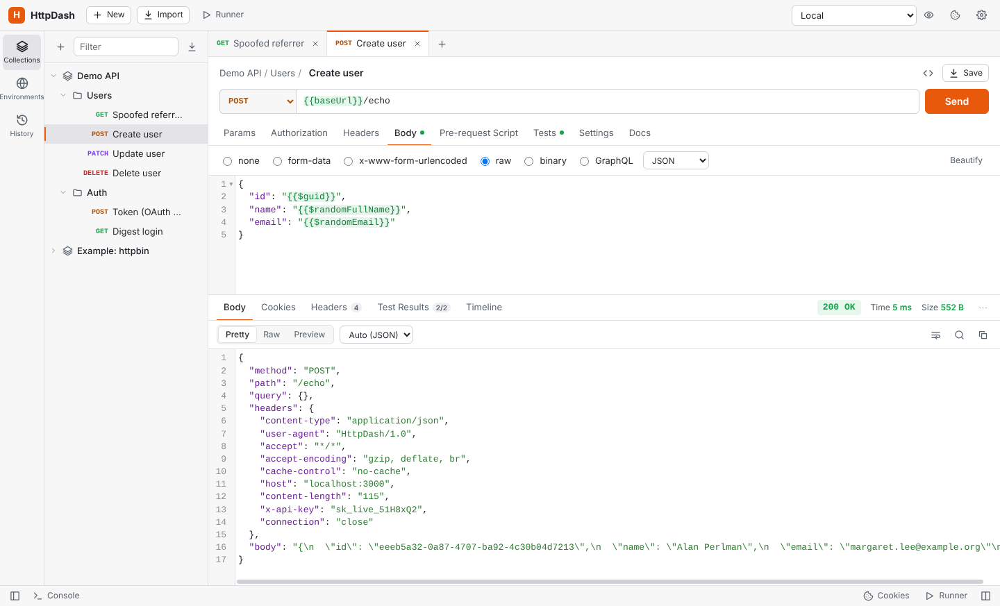
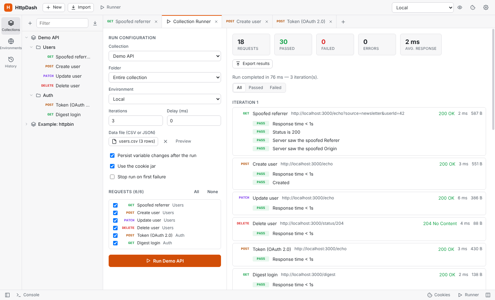
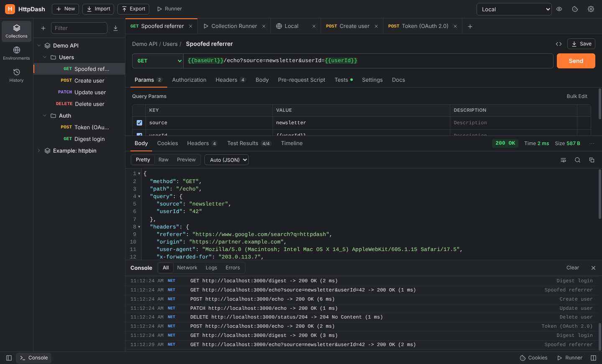

# HttpDash

A Postman-style API client for the desktop, built with Electron and plain JavaScript (no build step).



## Run it

```bash
npm install
npm start
```

Run the engine's unit tests (HTTP client, auth, scripts, runner, importers, code generation) with `npm test`.

Data is stored as JSON in Electron's `userData` folder (Settings → Data shows the path). Set `HTTPDASH_DATA_DIR` to use a different folder.

## Download / build for macOS and Windows

Every push and pull request runs the GitHub Actions workflow in `.github/workflows/build.yml`, which tests the app and then builds:

| Platform | Files |
| --- | --- |
| macOS (Intel and Apple Silicon) | `HttpDash-<version>-mac-x64.dmg`, `…-mac-arm64.dmg`, plus `.zip` versions |
| Windows (x64 and ARM64) | `HttpDash-Setup-<version>-x64.exe` / `-arm64.exe` installers, and a no-install `HttpDash-<version>-portable.exe` |

Download them from the workflow run's **Artifacts**. Pushing a tag such as `v1.0.0` also attaches them to a GitHub Release.

To build locally, run `npm run dist:mac` on a Mac or `npm run dist:win` on Windows. Output goes to `dist/`.

**Code signing.** Without certificates, the Mac build is ad-hoc signed and the Windows build is unsigned:
- **macOS:** the first launch is blocked by Gatekeeper. Right-click the app and choose **Open**, or run `xattr -cr /Applications/HttpDash.app`.
- **Windows:** SmartScreen may warn. Choose **More info → Run anyway**.

To sign (and notarize on Mac), add these repository secrets; the workflow picks them up automatically:
- macOS: `MAC_CSC_LINK` (base64 .p12), `MAC_CSC_KEY_PASSWORD`, `APPLE_ID`, `APPLE_APP_SPECIFIC_PASSWORD`, `APPLE_TEAM_ID`
- Windows: `WIN_CSC_LINK`, `WIN_CSC_KEY_PASSWORD`

## Team sharing through git

Share collections and environments with your team through any git repository: GitHub, GitLab, Bitbucket, Azure DevOps, Gitea or your own server. Open **Team** in the sidebar and connect a repository:

1. **Repository:** enter its URL (HTTPS or SSH), the branch, and optionally a folder, so the workspace can live inside an existing project repository.
2. **Sign-in:** either use this computer's git (SSH keys, Git Credential Manager, stored credentials), or save an access token. Tokens are encrypted with the system keychain and kept out of the workspace, exports and the repository.
3. **Shared items:** tick the collections and environments to share, then click **Sync**.

Teammates connect the same repository and click **Get latest**; the shared items appear in their sidebar with a team badge.

- **Sync** saves your shared items, commits them (with your message, or a summary of what changed), merges teammates' changes and pushes.
- **Get latest** brings in teammates' changes without pushing yours.
- **Conflicts:** each request is its own file, so two people rarely edit the same file. When they do, HttpDash lists the files and you choose **Keep mine**, **Keep the team's** or **Cancel sync**. Changes to other items merge either way.
- **Secrets stay local:**
  - Secret variables and auth-dependency tokens are written with empty values; everyone keeps their own.
  - Before pushing, the secret scan checks what is about to be shared and warns about plain-text credentials.
- **Open tabs:** tabs follow the team's version unless they have unsaved edits.
- **History:** recent commits are shown, and every sync is recorded in the audit log.

Git must be installed (it usually is on macOS; on Windows, install it from git-scm.com). The repository holds readable JSON, so changes can also be reviewed in pull requests:

```
httpdash.json
collections/orders-api/_collection.json        collection settings and variables
collections/orders-api/orders/_folder.json
collections/orders-api/orders/list-orders.request.json
environments/staging.json
```

| | |
| --- | --- |
|  Connecting a repository |  Choosing whose version to keep |

## Command-line runner (CI and schedulers)

Run collections without opening the app, like Postman's Newman. The runner needs Node.js 22+:

```bash
npm install -g github:restimguay/httpdash     # or, in a clone: npm run cli -- run …
httpdash list backup.json
httpdash run backup.json -c "CCER SGF1 QA" -e "CCER_SGF1_QA" --env-var password=$CCER_PASSWORD -r cli,junit
```

- **Input:** an HttpDash backup (**Export → HttpDash backup**, ideally with "Leave out secrets"), a Postman collection, or a `workspace.json`.
- **Environments:** pick one by name from the backup with `-e`, or pass a Postman environment file.
- **Secrets in CI:** pass them with `--env-var key=value`.
- **Other options:**
  - `-n` for iterations and `-d data.csv` for data-driven runs.
  - `--folder`, `--bail`, `--delay-request`, `--timeout-request`.
  - `-k` to skip SSL verification.
  - Reporters: `cli`, `json` and `junit` (JUnit XML is read by Jenkins, GitLab, Azure DevOps and GitHub test reporters).
- **What carries over from the app:** auth dependencies and scripts work exactly as in the app.
- **Exit codes:** `0` all passed, `1` a test or request failed, `2` bad arguments or input.

## Monitors

**Monitors** (sidebar) run a collection or folder on a schedule, from every minute to every 24 hours, against a chosen environment.
- **Results:** success rate, a duration chart, run history with the failed tests, and desktop notifications when a monitor fails or recovers.
- **Variables:** changes such as refreshed tokens can be kept.
- **When they run:** while HttpDash is open and unlocked. For round-the-clock checks, schedule the command-line runner with cron, Windows Task Scheduler or your CI.

## Mock server

Each collection has a **Mock server** tab that serves the examples saved on its requests. To save one, send a request, then use the response's "…" menu → **Save as example**.

- **Starting it:** pick a port, an optional delay, and whether other devices on your network may connect; then start it. **Use in an environment** creates a copy of your environment whose `{{BASE_URL}}`-style variables point at the mock, and switches to it.
- **Matching:** routes match on method and path. `:id` and `{{variable}}` segments match any value, and literal segments win.
- **Choosing an example:** clients can pick a specific one with the `x-mock-response-name` or `x-mock-response-code` header.
- **Other behaviour:**
  - CORS is enabled.
  - Requests without examples answer 501 with a hint, and unknown paths list the available routes.
  - Recent requests are shown live.
  - Mock servers stop when the app locks or quits.

## Secret scan and audit log

**Tools → Scan for Secrets** (also in Settings → Security and the Export dialog) looks for credentials typed directly into requests:
- AWS, GitHub, Slack, Stripe and Google keys, private keys and JWTs;
- passwords in URLs;
- plain-text auth fields and `Authorization`/key/token headers;
- secrets in scripts and bodies;
- sensitive-looking variables that aren't marked secret.

One click moves a value into a secret variable (keeping prefixes like `Token {{…}}`) or marks a variable as secret.

**Tools → Audit Log** keeps a local record (`audit.log`, rotated at 5 MB) of app starts, sign-ins and locks, lock setting changes, exports and imports, requests sent, collection and monitor runs, and mock servers. It records who, when and what. Request entries store only method, host, path and status, never headers, bodies or query values. You can filter, export (JSON Lines) or clear it; clearing is itself recorded.



## App lock with LDAP sign-in

HttpDash can require a directory (LDAP) sign-in before it opens. Set it up in **Settings → Security**:

1. **LDAP server:**
   - Enter the server address: `ldap://…:389` or `ldaps://…:636`, with optional StartTLS and certificate verification.
   - Choose how to find the user. Either a DN template such as `uid={username},ou=people,dc=example,dc=com`, or search then bind: a service account searches a base with a filter such as `(uid={username})`. Use the second when users live in different branches.
   - Optionally require membership of a group. HttpDash checks `member`, `uniqueMember` and `memberUid`.
2. **Test a sign-in** with your own account.
3. **Turn the lock on**, which is only possible after a successful test of the current settings:
   - Choose which users may unlock.
   - Optionally lock after N minutes of inactivity.
   - Save the one-time **recovery code**.

Once on, HttpDash starts locked. You can lock it any time with the lock button in the top bar or **Ctrl/Cmd+L**.

- **What locked means:** the main process refuses to hand any workspace data to the window until a sign-in succeeds, so nothing is in the window to read.
- **Recovery code:** if the LDAP server is unreachable, the code unlocks HttpDash and turns the lock off, so you can fix the settings.
- **Changing settings:** with the lock on, the LDAP settings are read-only. Turning the lock off requires signing in again.
- **Safety measures:**
  - Empty passwords are refused, because many LDAP servers treat them as an anonymous bind that "succeeds".
  - Usernames are escaped before they go into LDAP filters and DNs.
  - Repeated failures are slowed down.
  - The service-account password is encrypted with the OS keychain.
  - Lock settings live in their own `security.json`, which backups never include.
- **Limitation:** the lock protects the app; it does not encrypt your data files on disk.


## Import and export everything

**Export** (top bar) offers two formats:
- **HttpDash backup:** one `.json` file with everything: collections, environments, globals, history, service discovery sources, settings and cookies.
- **Postman format:** a folder with one `.postman_collection.json` per collection, one `.postman_environment.json` per environment, and a globals file, ready for Postman or teammates. Auth dependencies and discovery sources are HttpDash-only, so they are not in these files.

Tick **Leave out secrets** before sharing an export. This empties secret variables and the variables holding auth-dependency tokens, removes credentials typed into auth fields (references like `{{token}}` are kept), and drops discovery tokens, the proxy password and cookies. Without it, the file contains your credentials.

**Import** accepts all of these, and several files can be selected at once (for example a whole Postman export folder). For a backup, you choose:
- **Merge:** adds everything; items that already exist are added as copies marked "(imported)", and existing global keys are kept.
- **Replace:** swaps your current workspace for the backup. It asks for confirmation first.



## Auth dependencies (auto-refresh tokens)

A collection, folder or request can name another request, such as **Login**, to run first when the token it needs is missing or expired. Set it up in the **Authorization** tab under **Auth dependency**:

1. Set the collection's auth to **Bearer Token** with `{{token}}`.
2. Choose **Run a request first** and pick the login request.
3. Fill in where the token sits in the login response, for example `access_token` or `data.access_token`, and optionally the `expires_in` path.

On every send, HttpDash checks `{{token}}`:
- **Empty or expired:** it runs the login request first, saves the new token (and its expiry) in the environment, then sends your request.
- **Still valid:** it sends your request straight away.

Expiry comes from the expiry variable, which is computed from `expires_in`. If there's no expiry variable, it uses a JWT token's `exp` claim. The token is refreshed 30 seconds early by default.

More details:
- **Retry on 401:** optionally, if the server still answers 401, it refreshes the token and retries once.
- **Inheritance:** requests and folders inherit the setting, or can override it or turn it off.
- **No loops:** the login request never depends on itself.
- **Collection Runner:** it logs in once and reuses the token, even if the login request is unticked in the run.
- **Visibility:** the response shows a banner when a dependency ran, and the Timeline shows its details.

Auth dependencies are saved in HttpDash's workspace. Postman's export format has no field for them, so they are not included when you export to Postman.



## Service discovery (auto-create environments)

Point HttpDash at a service registry and it builds an environment with one variable per service. For example, `{{orders_url}}` = `http://10.0.1.5:8080`, so requests can use `{{orders_url}}/api/orders`.

To add a registry, open **Environments** in the sidebar and click **Service discovery → +**.

| Registry | What it reads |
| --- | --- |
| Consul | `/v1/catalog/services` plus each service's healthy instances. Options: ACL token, datacenter, tag filter, http/https. |
| Eureka (Spring Cloud) | `/eureka/apps`, instances with status UP only. Uses each app's home page URL or its host and port. |
| Kubernetes | Services in a namespace (or `*` for all), using a service-account bearer token and an optional label selector. The address can be the cluster DNS name, the cluster IP, or the external LoadBalancer address. |
| Custom JSON | Any endpoint returning a list of services or a `{ "name": "url" }` map. You set the list path, the name field, and a URL field or template such as `http://{host}:{port}`. |

- **Preview services** shows what would be created, without changing anything.
- **Create environment** makes the environment the first time.
- **Sync / Re-sync** updates the same environment in place: changed URLs are updated, new services are added, and services that vanished are removed (unless you tick "keep"). Variables you added yourself, such as API keys, are never touched.
- **Variable names** follow a pattern: `{name}_url` by default, or `{NAME}_BASE` for upper case.
- **Startup sync:** each source can be set to sync automatically when HttpDash starts.
- **Settings:** registry requests use your proxy settings, and SSL verification can be turned off per source (useful for Kubernetes API servers with self-signed certificates).



## Spoofing Referer, Origin, User-Agent and other headers

Requests are sent from Node's HTTP stack, not a browser, so none of the browser's "forbidden header" rules apply. Whatever you put in the **Headers** tab is sent exactly as written, including:
- `Referer`, `Origin` and `User-Agent`
- `Host` (useful for virtual hosts)
- `Cookie` (overrides the cookie jar for that request)
- `X-Forwarded-For` and other `Sec-*` headers

The header-name field autocompletes common headers. A custom `Referer` is kept when redirects are followed.

Some of these are set automatically if you don't set them (User-Agent, Accept, Accept-Encoding, Cache-Control, Host, Content-Type, Content-Length). Your own value always wins; **Show auto-generated** in the Headers tab lists them. The default User-Agent can be changed in Settings.

## Features

**Requests**
- Any HTTP method, URL bar with `{{variable}}` highlighting, hover tooltips and autocomplete
- Query params table synced with the URL, path variables (`/users/:id`), headers with bulk edit
- Bodies: raw (JSON / XML / HTML / JavaScript / text, with beautify and JSON linting), `form-data` with file uploads, `x-www-form-urlencoded`, binary file, GraphQL (query + variables)
- Auth: inherit from parent, Basic, Bearer, API key (header or query), Digest, OAuth 2.0 (client credentials and password grants, with a "Get New Access Token" button), AWS Signature v4
- Per-request settings: follow redirects, SSL verification, cookies, timeout
- Paste a cURL command into the URL bar to import it

**Responses**
- Status, time and size, with a breakdown of DNS / connect / TLS / first byte
- Pretty (JSON / XML / HTML formatting), Raw, Preview (sandboxed HTML, images) and Visualize (`pm.visualizer.set` with Handlebars-style templates)
- Search, line wrap, copy, save to file, save as example
- Headers, cookies, test results with filters, and a timeline showing the request actually sent and any redirects

**Scripts** (Postman-compatible `pm` API)
- Pre-request and test scripts on collections, folders and requests, run in Postman's order
- `pm.environment` / `globals` / `collectionVariables` / `variables` / `iterationData`, `pm.request` (headers, URL, query, body), `pm.response` (`json()`, `text()`, `headers`, `code`, `responseTime`)
- `pm.test`, `pm.expect` (Chai), `pm.response.to.have.status(...)` / `.header(...)` / `.jsonBody(...)` / `.jsonSchema(...)` / `.be.success` and similar
- `pm.sendRequest`, `pm.setNextRequest`, `pm.cookies`, `pm.visualizer`, `pm.execution.skipRequest`
- `CryptoJS` (MD5, SHA, HMAC, encoders), `atob` / `btoa`, `console.*` output in the Console panel, and legacy `tests[...]`, `postman.*`, `responseBody`
- Snippet library in the script editor

**Organisation**
- Collections and nested folders with drag-and-drop, rename, duplicate, delete and "Copy as cURL"
- Collection / folder settings: description, auth, scripts, collection variables
- Environments (with secret values), globals, environment quick look, dynamic variables (`{{$guid}}`, `{{$timestamp}}`, `{{$randomEmail}}`, …)
- History grouped by day, multiple tabs with unsaved-change tracking, all restored on restart

**Collection Runner**
- Run a collection or folder, choose which requests to include, environment, iterations and delay
- CSV / JSON data files (one iteration per row), `pm.setNextRequest` flow control, stop on failure
- Live results with per-request tests, request/response details and exportable JSON results
- Optionally persists variable changes made during the run

**Import / export & tools**
- Import HttpDash backups, Postman collections (v2.0 / v2.1), environments and globals, OpenAPI 3 / Swagger 2 (JSON) and cURL; drag files onto the window to import
- Export everything as a restorable backup or as Postman files, or export single collections, environments and globals
- Code generation: cURL, raw HTTP, JavaScript fetch, Node.js Axios, Python requests, Go, PHP cURL, C# HttpClient, Java OkHttp, PowerShell, wget
- Cookie manager (view / add / edit / delete per domain)
- Settings: timeout, redirects, SSL verification, HTTP proxy (including HTTPS via CONNECT, with auth and bypass list), user agent, response size limit, light / dark / system theme, editor font size, stacked or side-by-side layout
- Console panel with network and script logs; keyboard shortcuts (Ctrl/Cmd+T, Enter, S, W, O)

## Screenshots

| | |
| --- | --- |
|  Test scripts and results |  Timeline of the exact request sent |
|  JSON body with dynamic variables |  OAuth 2.0 token helper |
|  Code generation |  Collection runner with a data file |
|  Environments (dark theme) |  Console |

## Not included

Compared with Postman, these are not implemented: WebSocket, gRPC, Socket.IO and MQTT requests; OAuth 2.0 authorization-code and implicit flows; NTLM, Hawk and Akamai auth; client certificates; API documentation publishing and hosted cloud sync (team sharing works through git instead); YAML OpenAPI import.

Scripts run in Node's `vm` module in the main process. That is not a security boundary, so only run collections whose scripts you trust (Postman has the same caveat).

## Website

The marketing site for httpdash.com lives in `website/`: plain HTML, CSS and a little JavaScript, with no build step. `.github/workflows/pages.yml` deploys it to GitHub Pages whenever `website/` changes on `main`. To serve it from httpdash.com:

1. In the repository's **Settings → Pages**, set **Source** to **GitHub Actions**, and enter `httpdash.com` as the custom domain.
2. At your DNS provider, point `httpdash.com` at GitHub Pages: `A` records to `185.199.108.153`, `185.199.109.153`, `185.199.110.153` and `185.199.111.153`, plus a `CNAME` for `www` to `restimguay.github.io`.
3. Once the certificate is issued, tick **Enforce HTTPS**.

The download buttons link to the latest GitHub release.

## Layout

```
src/core/      request engine (no Electron dependency, unit-tested)
  http-client.js  HTTP/HTTPS with timings, redirects, decompression, proxy
  executor.js     variables, auth, bodies, scripts, cookies -> response
  sandbox.js      the pm.* script API
  runner.js       collection runner and CSV/JSON data files
  postman.js      Postman / OpenAPI import and export
  curl.js         cURL parser
  codegen.js      code snippet generators
  repo-format.js  team repository file format
  gitsync.js      team sync through git
src/main/      Electron main process, IPC, persistence, preload bridge
src/renderer/  UI (plain JS + CodeMirror 5)
test/          node:test unit tests against a local echo server
```
